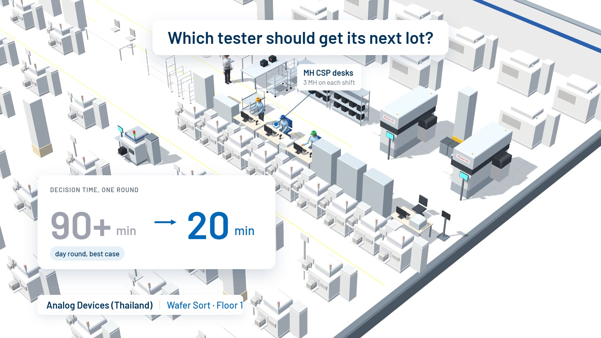
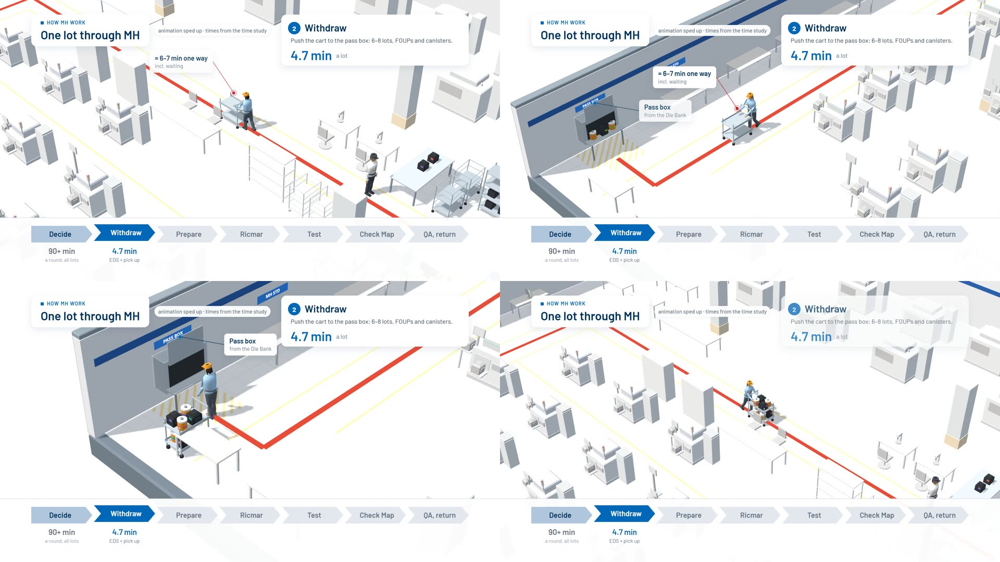
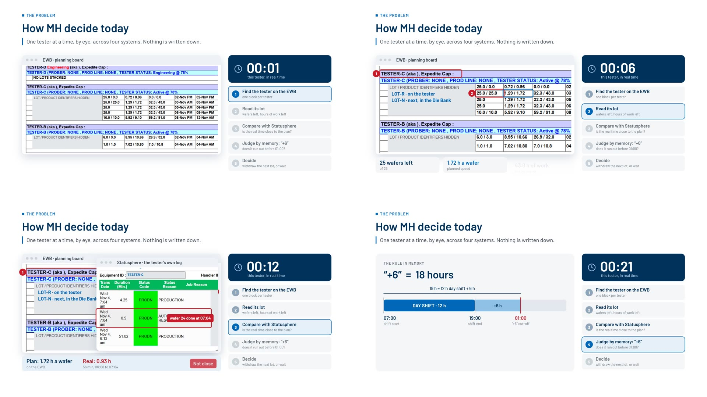
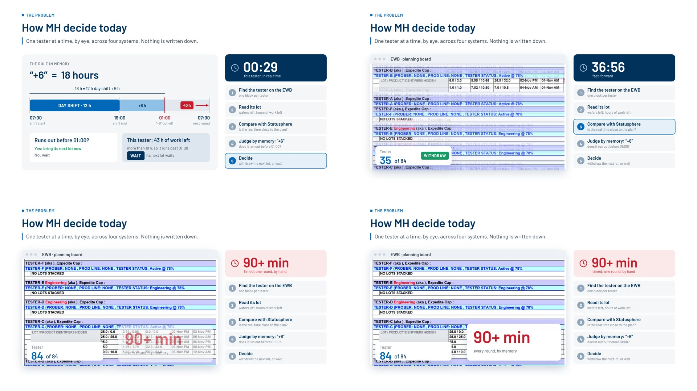
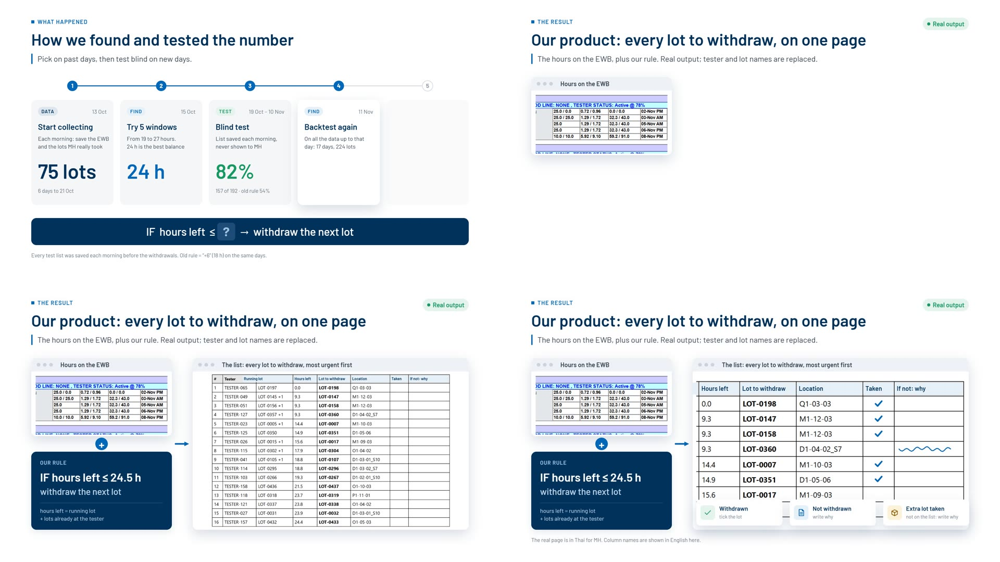

# One Day of MH in Wafer Sort

A 5-minute film about my senior project: **Process Improvement of the Wafersort Material-Handling Operation (DMAIC)**, IE Co-op Final Project 2026.

## ▶ Watch it in the browser

**https://chokylion.github.io/mh-wafersort-video/**

The player page has both versions (with narration, or music only), English subtitles and scene buttons. Nothing to download.

| File | What it is |
|---|---|
| `film-voice.mp4`, `film-music.mp4` | Web copies that the player page uses (1080p, 34 MB each) |
| [Latest release](../../releases/latest) | Full-quality files to download: `MH-WaferSort-5min-EN-voice.mp4` (English narration + backing track) and `MH-WaferSort-5min-EN-music.mp4` (backing track and sound effects only, the base for my own voice-over) |

1920×1080, 24 fps, 4 min 59.75 s.

## What the film says

Every morning, Material Handlers (MH) must answer one question for more than 80 testers: *which tester should get its next lot of wafers?*
By hand it took more than 90 minutes a round. The project wrote the rule down (IF hours left ≤ 24.5 h → withdraw the next lot),
turned it into one printed list, and brought the round we timed down to 20 minutes. On seven new days the list held 85% of the lots MH really took.
MH still decide.

| Time | Scene |
|---|---|
| 0:00 | The question |
| 0:18 | Where MH sits |
| 0:36 | One lot through MH (3D walk-through) |
| 1:22 | Where a shift goes |
| 1:46 | How MH decide today |
| 2:30 | Why it matters |
| 2:49 | One number, one IF |
| 3:09 | Finding the number |
| 3:45 | The product: the list |
| 4:12 | What we measured |
| 4:33 | Same team, more time |

## Frames

| | |
|---|---|
|  |  |
|  |  |
|  | |

## In this repository

| File | What it is |
|---|---|
| `DUBBING-SCRIPT.md` | Every narration line with the time it starts and ends |
| `script-EN.json` | The same script as data |
| `MH-WaferSort-5min-EN.srt` | English subtitles |
| `FACTS.md` | Every number on screen and where it comes from |
| `index.html`, `MH-WaferSort-5min-EN.vtt` | The player page and its subtitles |

## How it was made

Every frame is drawn in code: a three.js model for the factory and the floor, and a 2D canvas for the infographics,
rendered frame by frame and joined with ffmpeg. The backing track is written in code from CC0 instrument samples (VCSL).
The narration in the `-voice` file is a placeholder (Kokoro, an offline text-to-speech voice).

Tester, lot and product names are replaced, and estimates are labelled as estimates.
The 3D floor is a simplified drawing; the walking is sped up and the times shown come from the time study.
